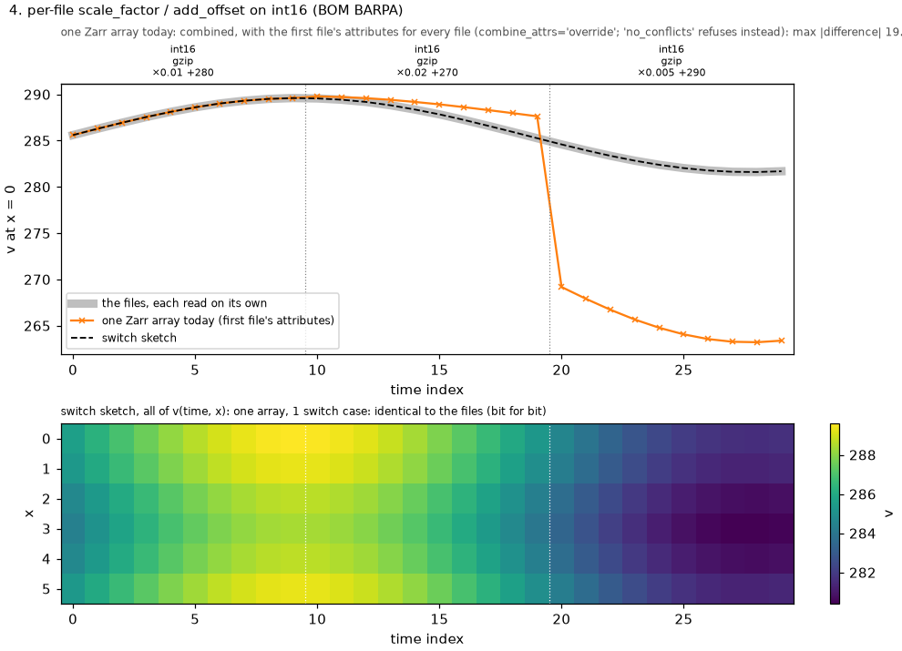
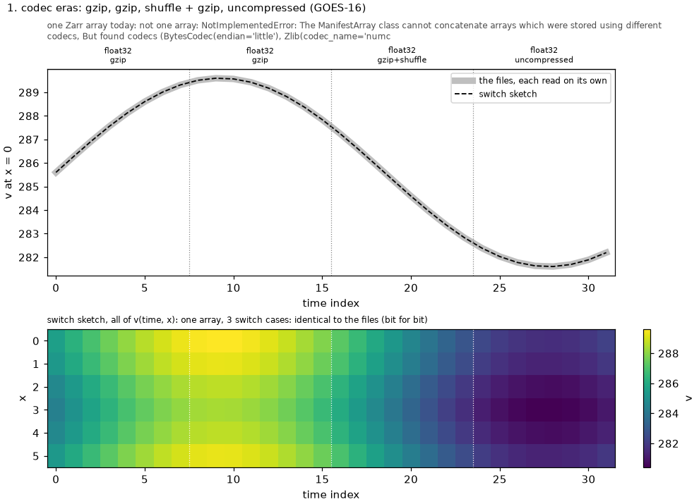
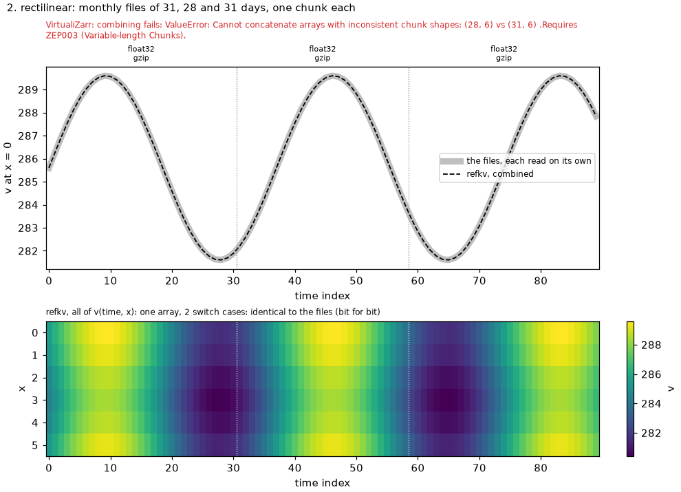
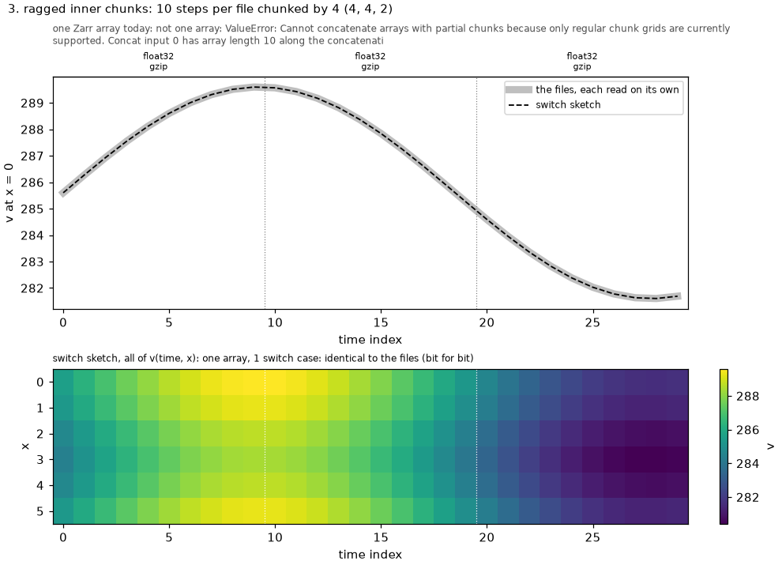
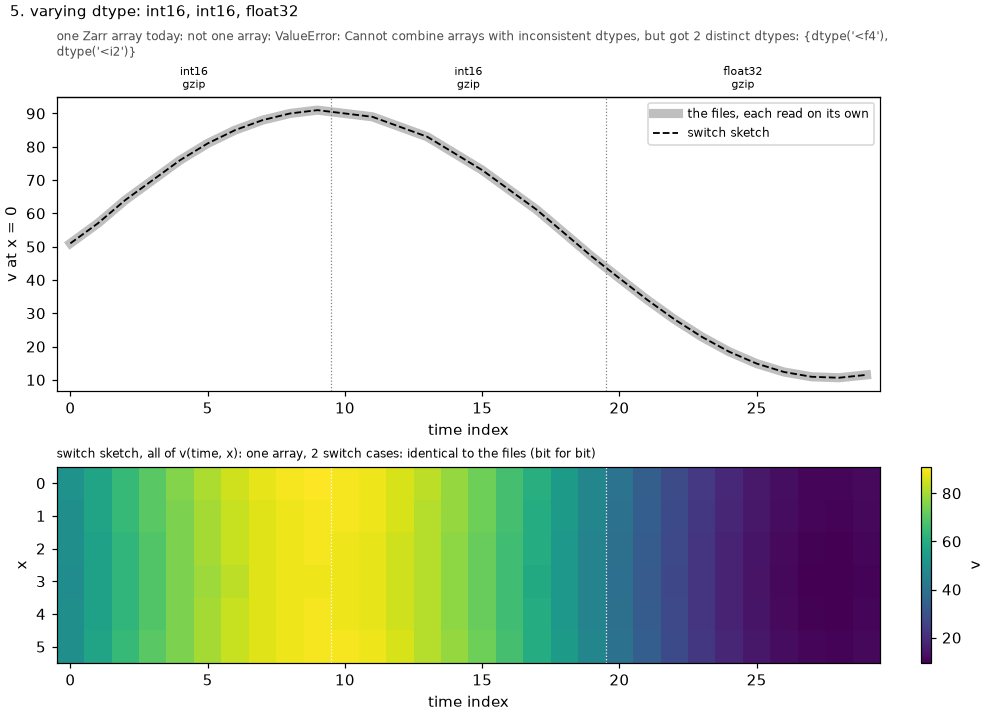

# Inhomogeneous files: the zarr-specs#399 cases, and a per-chunk codec sketch

An executable companion to
[zarr-developers/zarr-specs#399](https://github.com/zarr-developers/zarr-specs/issues/399)
("Varying codec parameters per-chunk"). [demo.py](demo.py) writes small netCDF4
files in the five shapes the issue describes. Each file is valid and consistent on its
own, and VirtualiZarr parses every one of them without trouble.

The demo looks at the next step: one logical array along time.

- **One Zarr array today.** This is `xr.concat` of the virtual datasets, as
  `open_virtual_mfdataset` does it. A Zarr array has one codec chain, one dtype, one
  regular chunk grid and one set of attributes. So VirtualiZarr refuses combinations
  that would need more, and its errors say what's missing (it names ZEP003 for
  variable-length chunks). That refusal is the safe behavior; the gap it reports is
  the one the issue is about.
- **A sketch of design 2.1 from the issue.** The same per-file manifests from
  VirtualiZarr are combined by [switch.py](switch.py) into one array whose chunks each
  select their own codec chain. That array is saved as a vzip archive with refkv,
  reopened, and read through zarr-python and xarray.

```bash
cd design/experiments/inhomogeneous && uv run demo.py
```

`demo.py` declares its dependencies inline
([PEP 723](https://peps.python.org/pep-0723/)), so `uv run` builds an environment for
it alone, with refkv from PyPI. It doesn't use this repository's environment. The two
files, `demo.py` and [switch.py](switch.py), run from any directory.

| case | the files | one Zarr array today | switch sketch |
|---|---|---|---|
| 1. codec eras (GOES-16) | gzip, gzip, shuffle + gzip, uncompressed | not expressible: one codec chain per array | bit for bit, 3 cases |
| 2. rectilinear chunks (monthly files) | 31, 28 and 31 days, one chunk each | not expressible: needs variable-length chunks (ZEP003) | bit for bit, rectilinear grid |
| 3. ragged inner chunks (tiled cubes) | 10 steps each, chunked by 4 (4, 4, 2) | not expressible: partial chunks inside a regular grid | bit for bit, rectilinear grid + `crop` |
| 4. per-file `scale_factor` / `add_offset` (BOM BARPA) | int16, each file with its own CF scaling | one array, one set of attributes (see below) | bit for bit, 3 cases |
| 5. varying dtype | int16, int16, float32 | not expressible: one dtype per array | bit for bit, 2 cases |

Case 4 is the subtle one, and it isn't specific to any tool. CF scaling is array-level
attributes, and one array has one set, so concatenating the files has to choose:

- **`combine_attrs="override"`** is the default in both `xr.concat` and
  `open_virtual_mfdataset`. It keeps the first file's `scale_factor` and `add_offset`,
  so the other files' integers decode with the wrong scaling: 120 of 180 values are
  off, by up to 19.6.
- **`"no_conflicts"`** refuses the combination.
- **`"drop_conflicts"`** drops the scaling, leaving the raw integers.

None of these gives one correctly scaled array, because the scaling varies per file.
That's the issue's point: the per-file context has to live somewhere per chunk.

## How the results are checked

- **The reference.** Each file is read on its own by xarray with h5netcdf, which
  applies HDF5's own filters (deflate, shuffle) and xarray's CF decoding
  (`scale_factor`, `add_offset`, `_FillValue`). The decoded arrays are concatenated
  along time.
- **The combined arrays.**
  - The concatenated virtual dataset is read through Zarr, using refkv's in-memory
    store for its manifest.
  - The switch sketch is saved as a vzip archive, reopened, and read through
    zarr-python and xarray.
- **The comparison.** "Bit for bit" means `np.array_equal(..., equal_nan=True)`, with
  no tolerance. Otherwise the run reports the largest absolute difference, and how
  many values are off by more than 0.001.
- **The data.** Each case's files hold one smooth field, `v(time, x)`, that continues
  across the files. A file decoded with another file's codecs, dtype or scaling shows
  as a break at its boundary.

[`figures/`](figures/) has one plot per case:

- **Top panel:** `v` along time at `x = 0`, for the files and both combined arrays.
  The dotted lines are the file boundaries; each file's encoding is labeled above its
  span.
- **Bottom panel:** all of the sketch's `v(time, x)`.



| | | |
|---|---|---|
| [](figures/case1.png) | [](figures/case2.png) | [](figures/case3.png) |
| [](figures/case5.png) | | |

The archives hold a few kilobytes of metadata; the chunks are read in place from
the netCDF files. [output.txt](output.txt) is a full run.

## How the sketch works: one codec per transformation, and one that chooses

Each thing that varies between the files is its own, independent codec:

| what varies per file | codec |
|---|---|
| compression, shuffle | the file's own codecs, as VirtualiZarr's HDF5 parser reports them (`numcodecs.zlib`, `numcodecs.shuffle`) |
| stored dtype | [`cast_value`](https://github.com/zarr-developers/zarr-extensions/tree/main/codecs/cast_value) (zarr-extensions, in zarr-python 3.4) |
| CF `scale_factor` / `add_offset` | [`scale_offset`](https://github.com/zarr-developers/zarr-extensions/tree/main/codecs/scale_offset) (zarr-extensions, in zarr-python 3.4) |
| stored chunk shape (HDF5 stores edge chunks whole) | `crop` (new: decodes by keeping the cell, encodes by padding) |

One codec, `switch`, chooses per chunk which composition of them applies.

- **What `switch` is.** It is an array-to-bytes codec,
  `{"cases": [{"codecs": chain, "parameters": [data_type, ...]}, ...]}`.
  - **Each case is an ordinary Zarr codec chain that may leave numbers open.**
    `{"parameter": k}` anywhere in a codec's configuration stands for the chunk's
    k-th parameter.
  - **A chunk's bytes start with a header:** a varint case index, then that case's
    parameters, each little-endian in its declared data type.
  - **`switch` fills in the case with those values and decodes the rest with it,** the
    way `sharding_indexed` decodes inner chunks with its inner chain.
- **Where the header comes from.** refkv's reference values carry it. A chunk is
  `Concat(Range(data=<header>), Range(source=<file>, offset, length))`: a few literal
  bytes in the archive's index, then the file's own bytes.
- **What goes where.** `zarr.json` holds the *kinds* of encoding: in case 4, one case
  for all three files. Each file's `add_offset` and the reciprocal of its
  `scale_factor` travel in its chunks' headers, 17 bytes each. Chunks that differ only
  in numbers share a case.
- **Grids.** Month-length and ragged files use the zarr-extensions
  [`rectilinear`](https://github.com/zarr-developers/zarr-extensions/tree/main/chunk-grids/rectilinear)
  chunk grid.

Case 4's array, with its one case:

```json
"data_type": "float32",
"chunk_grid": {"name": "rectilinear", "configuration": {"kind": "inline", "chunk_shapes": [[5, 5, 5, 5, 5, 5], [6]]}},
"codecs": [{"name": "switch", "configuration": {"cases": [{
  "codecs": [
    {"name": "scale_offset", "configuration": {"offset": {"parameter": 0}, "scale": {"parameter": 1}}},
    {"name": "cast_value", "configuration": {"data_type": "int16",
      "scalar_map": {"encode": [["NaN", -32767]], "decode": [[-32767, "NaN"]]}}},
    {"name": "crop", "configuration": {"shape": [5, 6]}},
    {"name": "bytes", "configuration": {"endian": "little"}},
    {"name": "numcodecs.zlib", "configuration": {"level": 4}}],
  "parameters": ["float64", "float64"]}]}}]
```

## Scaling: when every chunk is encoded differently

A table of whole chains grows with the number of distinct encodings, and every reader
reads the whole table before its first chunk. [scaling.py](scaling.py) measures the
worst case: N chunks, each packed with its own CF scale and offset (as GRIB packs each
message), in one source file. It describes the same array two ways:

- **One case per chunk:** each chunk's numbers are written into its own case.
- **One case, two parameters:** each chunk's numbers are in its header.

```bash
uv run scaling.py
```

| chunks | design | `zarr.json` | archive | open the array | read one chunk |
|---|---|---|---|---|---|
| 1,000 | one case per chunk | 378 kB | 0.50 MB | 0.02 s | 2.0 ms |
| 1,000 | one case, two parameters | 0.8 kB | 0.16 MB | 0.00 s | 1.4 ms |
| 10,000 | one case per chunk | 3.8 MB | 5.05 MB | 0.17 s | 1.9 ms |
| 10,000 | one case, two parameters | 0.8 kB | 1.58 MB | 0.02 s | 1.7 ms |
| 100,000 | one case per chunk | 37.7 MB | 51.0 MB | 2.26 s | 1.8 ms |
| 100,000 | one case, two parameters | 0.8 kB | 16.1 MB | 0.28 s | 1.4 ms |

Both designs read 200 chunks spread over the array bit for bit
([scaling_output.txt](scaling_output.txt)).

- **One case per chunk.** `zarr.json` costs about 380 bytes per chunk, all read and
  parsed before the first chunk.
- **One case, two parameters.** `zarr.json` stays the same size whatever the chunk
  count. The parameters cost 17 bytes per chunk, in the reference each read already
  fetches. What still grows with N, about 160 bytes per chunk and 0.28 s to open at
  100,000, is the archive's own index of 100,000 keys. Any archive of that many chunks
  pays it.

That is the split in point 1 of the issue. Context chunks share goes in the metadata;
context per chunk goes in the manifest, which already exists per chunk. With
references that carry literal bytes, the second half needs no new mechanism.

## Why the chooser is generic, and the formats live in the transformations

The array-to-bytes codec could be scoped to the source product instead: a
netCDF-4/HDF5 codec whose variants are written in HDF5's own terms (datatype,
filter pipeline, chunk dimensions, CF packing), decoding with HDF5's semantics.
The design here splits that apart:

- **The chooser carries no format knowledge.** `switch` only selects a chain. The
  same codec combines TIFF tiles with different compressions, GRIB messages with
  different packing, or HDF5 files with different filters. One codec, not one per
  product.
- **Format knowledge goes where it varies: in single-purpose codecs** that any case
  can use. HDF5's deflate and shuffle are numcodecs codecs already. CF packing is
  `scale_offset`, dtypes are `cast_value`, and HDF5's whole edge chunks are `crop`.
  A product transformation with no Zarr equivalent (HDF5's Fletcher-32 checksum, its
  N-bit or scale-offset filters, SZIP) becomes one more single-purpose codec, usable
  in any case and outside `switch` too, rather than a branch inside a per-product
  codec.
- **Each piece is reviewable on its own.** A reader implements `switch` once.
  Everything inside a case is a codec it either knows or rejects as unknown.

A product-scoped codec would be the better choice only where a product's chunks
can't be described as a chain of independent transformations. That happens when a
per-chunk header has to be parsed: refkv's `n5_default` exists for exactly that
reason.

## Composition

- **Codecs outside `switch`.**
  - Array-to-array codecs listed before it (`transpose`, a uniform `scale_offset`)
    apply to every chunk, whatever its case.
  - Bytes-to-bytes codecs after it would apply to the index *and* the source's bytes,
    so a virtual array has none. A materialized array may.
- **Nesting.** A case is a full chain, so it may end in another `switch`. The chunk
  then starts with the outer index, then the inner one. This composes independent
  axes of variation, for example a codec era (outer) and a per-file scaling (inner),
  at the cost of repeating the inner table in each outer case.
- **Sharding.** A case may be `sharding_indexed` (a source stored as shards), and a
  shard's inner chain may use `switch` (inner chunks that vary).
- **Precedent:** [`conditional`](https://github.com/zarr-developers/zarr-extensions/tree/main/codecs/conditional)
  (zarr-extensions) already puts a per-chunk header in the chunk bytes, to turn codecs
  of one chain on or off. `switch` chooses among chains, so it also covers what
  `conditional` can't: a different dtype, scaling, or stored shape per chunk.
- **Concatenating two such arrays** (manifest-level operations, as VirtualiZarr does
  them) means joining their case lists and renumbering the case index at the start of
  each chunk's header. The parameters travel with the chunk unchanged, and so do the
  source bytes. Identifying cases by a hash of their canonical JSON instead of by
  position would make the join a union, with no renumbering.

## Limits

- **`switch` and `crop` are defined here**, not registered as zarr extensions.
- **`scale_offset` stores the encode multiplier; CF stores the decode one.** CF's
  `scale_factor` of 0.01 becomes `scale` 100.00000223517424, the reciprocal of float32
  0.01. Here decoding through `x / scale` gives exactly what `x * scale_factor` gives,
  bit for bit, but that isn't guaranteed for every factor and value: in general the
  two agree to within an ulp. A guarantee would need `scale_offset` to accept the
  factor in either direction.
- **The fill value must round-trip through every case.** The array's fill value is
  NaN, and an int16 case can't hold NaN. Each such case's `cast_value` therefore maps
  NaN to the file's CF `_FillValue` and back (`scalar_map`), which is what
  `_FillValue` means. A file without `_FillValue` has no lossless choice, so the demo
  refuses it. An earlier version used `out_of_range: "clamp"` with a fill of 0, which
  can't round-trip either; zarr-python 3.4 accepted it anyway. That is a zarr-python
  bug against the cast_value spec ("If the fill value cannot survive a round-trip
  cast, implementations MUST treat this as an error"), and it is being fixed
  separately.
- **zarr-python's `cast_value` needs the `cast-value-rs` package**, which the script declares.
- **Versions:** VirtualiZarr 2.7.3, zarr 3.4.0, xarray 2026.9.0, h5py 3.16.0.
